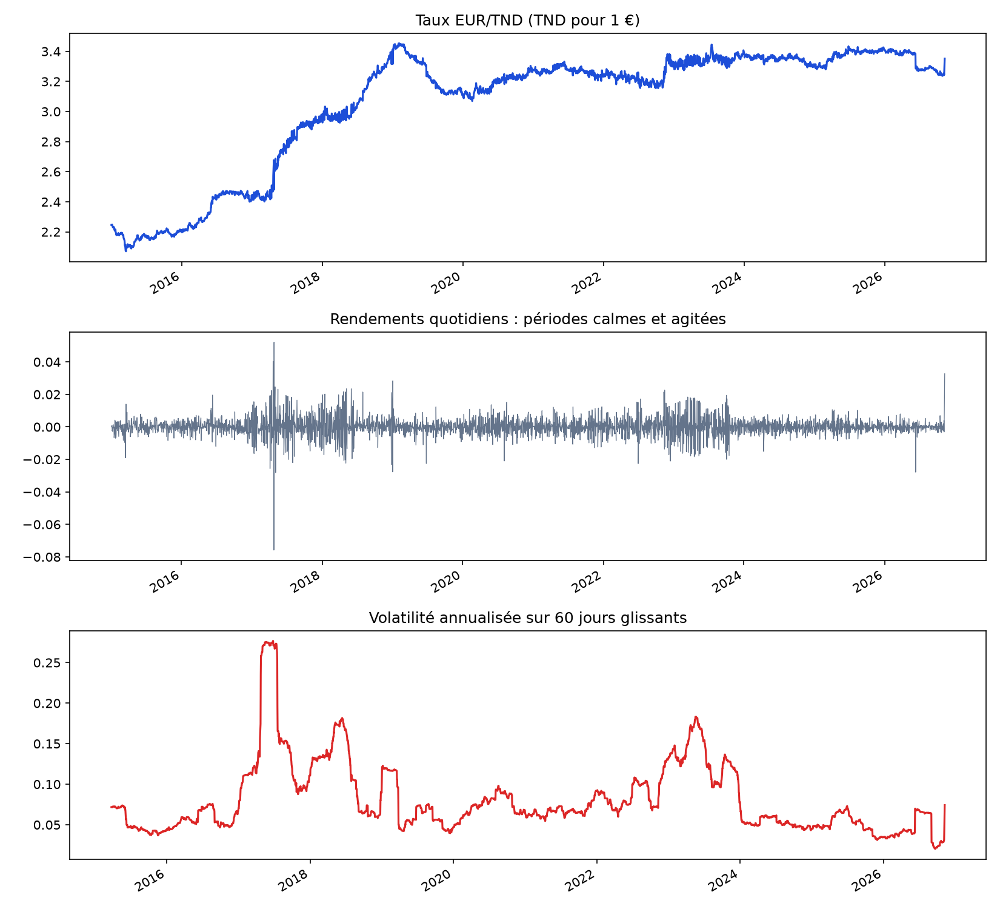
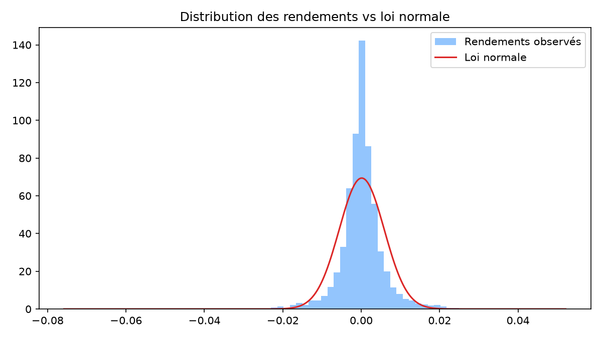
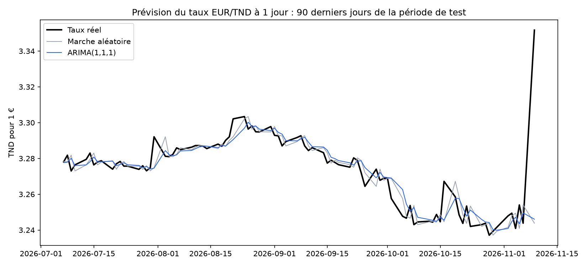

# Évolution et prévision du taux de change EUR/TND

Analyse de l'évolution de l'euro face au dinar tunisien depuis 2015, et test d'une prévision à un jour avec un modèle ARIMA, comparée à la règle la plus simple : « le taux de demain = le taux d'aujourd'hui ».

## Pourquoi ce sujet

Une entreprise tunisienne qui importe en euros paie ses factures en dinars : quand l'euro monte, le même achat coûte plus cher. Avant de chercher à se protéger, il faut comprendre comment le taux évolue et savoir s'il est possible de le prévoir.

## Données

- Taux EUR/TND quotidien depuis janvier 2015, téléchargé automatiquement depuis Yahoo Finance (`EURTND=X`)
- Contrôle qualité : repérage des allers-retours aberrants (un très gros saut immédiatement annulé le lendemain), remplacés par interpolation

## 1. Évolution du taux



| Indicateur | Résultat |
|---|---|
| Taux en janvier 2015 | 2,25 TND pour 1 € |
| Taux fin 2026 | environ 3,25 à 3,35 TND pour 1 € |
| Hausse de l'euro sur la période | environ +45 à +49 % |
| Volatilité annualisée | 9,1 % |
| Kurtosis (excès) | 16,4 (0 pour une loi normale) |
| Test ADF sur le taux | p-value = 0,16 : non stationnaire |
| Test ADF sur les rendements | p-value < 0,001 : stationnaire |

**Lecture**

- **Deux périodes** : une forte dépréciation du dinar entre 2016 et 2019, puis une relative stabilité autour de 3,1 à 3,4 TND.
- **L'agitation arrive par vagues** : la volatilité s'envole en 2017, 2018 et 2023, puis redescend. Elle n'est pas constante dans le temps.
- **Les gros chocs sont fréquents** : la distribution des rendements a un pic plus haut et des queues plus épaisses que la loi normale. Un modèle fondé sur la loi normale sous-estimerait les mouvements extrêmes.



## 2. Prévision à un jour avec ARIMA

**Méthode**

- Le taux n'étant pas stationnaire, on modélise ses variations : ARIMA(1,1,1) sur le logarithme du taux.
- Paramètres estimés sur l'historique, puis test sur les 250 derniers jours (environ un an). À chaque date, le modèle ne connaît que les jours précédents.
- Comparaison avec la marche aléatoire (« demain = aujourd'hui »), la référence classique pour les taux de change.



| Modèle | RMSE (TND) | MAE (TND) | Bon sens de variation |
|---|---|---|---|
| Marche aléatoire | 0,01168 | 0,00617 | – |
| ARIMA(1,1,1) | 0,01150 | 0,00578 | 61 % |

**Lecture**

- ARIMA fait légèrement mieux que la marche aléatoire : 1,6 % d'erreur en moins (RMSE) et le bon sens de variation 61 % du temps.
- Son coefficient MA de −0,50 indique un effet de retour : quand le taux saute un jour, il revient en partie le lendemain. Cela peut refléter l'encadrement du dinar par la Banque Centrale de Tunisie, ou du bruit dans les cotations.
- En revanche, le modèle n'anticipe pas les vrais mouvements de tendance : il les suit avec un jour de retard.

## Conclusion

Le taux EUR/TND a fortement augmenté depuis 2015, avec des périodes d'agitation marquées et des chocs plus fréquents que ne le prévoit la loi normale. Un modèle ARIMA apporte un gain faible sur la prévision du lendemain, mais ne permet pas d'anticiper les grandes évolutions. Pour une entreprise importatrice, la prévision ne suffit donc pas : il faut mesurer son exposition au risque de change et envisager des instruments de couverture.

## Limites

- Les données de Yahoo Finance pour le dinar peuvent contenir des erreurs de cotation. Le dernier cours disponible (3,35 TND) est notamment à confirmer avec le cours publié par la Banque Centrale de Tunisie.
- La prévision porte sur un horizon d'un jour. Sur plusieurs mois, l'incertitude devient beaucoup plus grande.
- Un seul modèle (ARIMA) est testé. Des modèles intégrant des variables économiques (inflation, taux d'intérêt) seraient une piste d'amélioration.

## Lancer le projet

```bash
pip install -r requirements.txt
python 01_donnees_exploration.py
python 02_nettoyage_prevision.py
```

Le premier script télécharge les données et enregistre les graphiques dans `figures/`. Le second nettoie les données et compare les prévisions.

## Outils

Python, pandas, NumPy, statsmodels (ARIMA, test ADF), Matplotlib, yfinance
